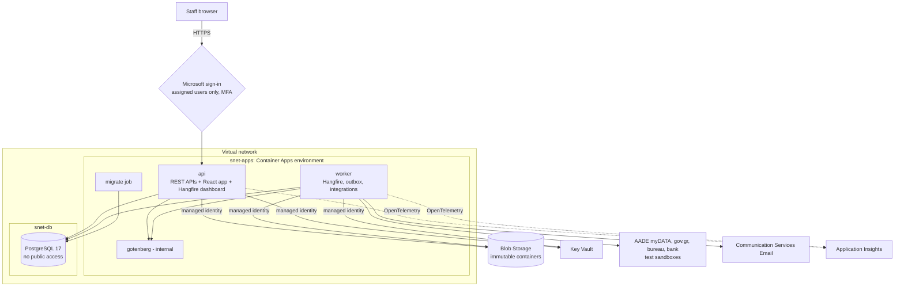

# Infrastructure Plan — Core Insurance System (Greece / EU P&C)

**Status:** Accepted · **Date:** 2026-10-07 · **Companion to:** [ARCHITECTURE-DECISIONS.md](ARCHITECTURE-DECISIONS.md)

This document lists every piece of infrastructure the system needs and how it is run in each of three stages:

| Stage | Where | Data | Approx. cost |
|---|---|---|---|
| **0 — Local** | Developer machine, Docker Compose | Synthetic only | €0 |
| **1 — Azure (dev/pilot)** | One Azure EU region, minimum-cost SKUs, Microsoft sign-in required for every user | Synthetic only | ≈ €30–45 / month (≈ €20–30 with off-hours shutdown) |
| **2 — Azure (production)** | Same templates with production SKUs, high availability and extra security services | Real customer data | Low thousands of € / month per legal-entity stamp |

Prices are indicative EU list prices. Confirm them in the Azure Pricing Calculator before committing.

---

## 1. Runtime components

The system has **three containers of our own**, plus PostgreSQL and file storage.

| Component | What it runs | Ingress |
|---|---|---|
| **api** | ASP.NET Core application: all module APIs (REST + OpenAPI), the React web app as static files, and the Hangfire dashboard (admin role only) | External, behind Microsoft sign-in |
| **worker** | The same .NET build, started in worker mode: Hangfire server (jobs, deadlines, batch), outbox dispatcher, integration worker (myDATA, gov.gr, bureau, bank and SMS adapters), report-mart builds | None |
| **migrate** (job) | The same .NET build, started in migration mode: EF Core migrations and reference-data seeding. Runs once per deployment | None |
| **gotenberg** | HTML → PDF/A rendering (headless Chromium) | Internal only |
| **PostgreSQL 17** | One database. One schema per module, plus `hangfire`, `plt` (outbox, audit, config) and `rpt_*` (reporting marts) | Private only |
| **Blob storage** | Rendered documents (immutable), inbound documents, audit archive (immutable), report exports | Private (firewalled) |

One image is built per commit. The `APP_ROLE` environment variable (`api`, `worker` or `migrate`) selects the mode.

---

## 2. Infrastructure per module

| Module | PostgreSQL | Hangfire jobs | Blob | External integration |
|---|---|---|---|---|
| PRD-01 Party & distribution | `pty`: `pg_trgm` + `unaccent` for Greek name search; `pgcrypto` for identifier encryption | Screening re-checks | KYC evidence | AADE registry, GEMI |
| PRD-02 Product factory | `pfc` | Scheduled version activation | — | — |
| PRD-03 Rating | Reads `pfc`; worksheets in `rat` | Shadow runs | — | Vehicle valuation, geocoding |
| PRD-04 Underwriting | `uw` | Referral SLA deadlines | — | gov.gr Wallet consent |
| PRD-05 Policy admin | `pol`: bitemporal tables with exclusion constraints (`btree_gist`) | Renewals, cancellations, cooling-off | — | — |
| PRD-06 Billing | `bil`: append-only ledger | Dunning, direct-debit runs | SEPA files | Banks (SEPA pain/camt), payment provider |
| PRD-07 Claims | `clm` | Statutory claim deadlines | Photos, reports | Email intake |
| PRD-08 Reinsurance | `ri` | Bordereaux | Bordereaux files | — |
| PRD-09 Finance | `fin`: append-only sub-ledger | Earning runs, period close | GL extracts | General ledger |
| PRD-10 Documents | `doc` | Rendering, delivery retries | **Immutable PDFs** | Gotenberg, email, SMS, gov.gr co-signing |
| PRD-11 Compliance | `cmp` | myDATA submission, bureau reporting, statutory clocks | Evidence packs | AADE myDATA, Information Centre / bureau |
| PRD-12 Channels | `chn` | Webhook delivery | — | Partner APIs (served by `api`) |
| PRD-13 Work management | `wrk` | SLA timers | Inbound documents | Email intake, OCR (optional) |
| PRD-14 Platform | `plt`: outbox, audit, config, flags, calendars, FX, retention, incidents | Outbox dispatch, retention purge | Audit archive | Entra ID, Key Vault, Azure Monitor |
| PRD-15 Data & analytics | `rpt_raw`, `rpt_conformed`, `rpt_mart` | Nightly mart builds, reconciliations | Report exports | Group reporting |
| PRD-16 Migration | `mig` staging | Migration batches | Source extracts | Legacy systems |
| PRD-17 Multi-market | Configuration layers in `plt` | — | — | Country packs are code; no extra infrastructure |

---

## 3. Stage 0: Local (free)

### 3.1 Machine and tools

| Item | Requirement |
|---|---|
| Hardware | 16 GB RAM minimum, 32 GB recommended; 30 GB free SSD |
| OS | Windows 11 with WSL2, macOS or Linux |
| Container runtime | Docker Desktop. It is free for personal use and small businesses (under 250 employees **and** under $10M revenue); larger organisations need a paid licence or can use Podman Desktop / Rancher Desktop |
| SDKs | .NET 10 SDK, Node.js LTS (front-end build only), Azure CLI, `psql` |
| Accounts | A Microsoft Entra ID tenant for dev app registrations (free) |

### 3.2 Local services (`infra/local/compose.yaml`)

| Service | Image (pin exact tags) | Port (bound to `127.0.0.1`) | Stage 1 equivalent |
|---|---|---|---|
| api | built from repo | 5000 | Container App `api` |
| worker | built from repo | — | Container App `worker` |
| PostgreSQL 17 | `postgres:17` | 5432 | Azure Database for PostgreSQL Flexible Server 17 |
| Azurite | `mcr.microsoft.com/azure-storage/azurite` | 10000 | Azure Storage account |
| Gotenberg | `gotenberg/gotenberg:8` | 3000 | Container App `gotenberg` (internal) |
| Mailpit | `axllent/mailpit` | 8025 (UI), 1025 (SMTP) | Azure Communication Services Email |
| WireMock | `wiremock/wiremock` | 8089 | Real test sandboxes (for example AADE myDATA development environment) |
| Aspire Dashboard | `mcr.microsoft.com/dotnet/aspire-dashboard` | 18888 (UI), 4317 (OTLP) | Application Insights |

The front end runs with `npm run dev` (Vite, port 5173), which proxies API calls to port 5000. In Stage 1 the built files are served by `api`.

```yaml
name: coreins
services:
  postgres:
    image: postgres:17
    environment:
      POSTGRES_PASSWORD: ${PG_PASSWORD}
    ports: ["127.0.0.1:5432:5432"]
    volumes:
      - pgdata:/var/lib/postgresql/data
      - ./pg-init:/docker-entrypoint-initdb.d   # creates database, roles and extensions
    command: ["postgres", "-c", "timezone=UTC"]

  azurite:
    image: mcr.microsoft.com/azure-storage/azurite
    command: azurite-blob --blobHost 0.0.0.0
    ports: ["127.0.0.1:10000:10000"]

  gotenberg:
    image: gotenberg/gotenberg:8
    ports: ["127.0.0.1:3000:3000"]

  mailpit:
    image: axllent/mailpit
    ports: ["127.0.0.1:8025:8025", "127.0.0.1:1025:1025"]

  wiremock:
    image: wiremock/wiremock:3x
    volumes: ["./wiremock:/home/wiremock"]
    ports: ["127.0.0.1:8089:8080"]

  otel:
    image: mcr.microsoft.com/dotnet/aspire-dashboard
    ports: ["127.0.0.1:18888:18888", "127.0.0.1:4317:18889"]

  migrate:
    build: ../..
    environment: { APP_ROLE: migrate }
    env_file: .env
    depends_on: [postgres]

  api:
    build: ../..
    environment: { APP_ROLE: api }
    env_file: .env
    ports: ["127.0.0.1:5000:8080"]
    depends_on: [migrate, azurite, gotenberg]

  worker:
    build: ../..
    environment: { APP_ROLE: worker }
    env_file: .env
    depends_on: [migrate, azurite, gotenberg, mailpit, wiremock]

volumes:
  pgdata:
```

### 3.3 Local security
- Every port is bound to `127.0.0.1`, so nothing is reachable from the network.
- Synthetic data only.
- Secrets are kept in `.env` (git-ignored); `.env.example` is committed.
- Sign-in uses the dev Entra ID tenant (redirect URI `http://localhost:5000/signin-oidc`), so authentication behaves exactly as in Azure.

---

## 4. Rules that keep local and Azure identical

1. Everything runs in containers built from one Dockerfile.
2. All configuration comes from environment variables (section 5); nothing environment-specific is in code.
3. The PostgreSQL major version and extension list are the same everywhere: `pg_trgm`, `unaccent`, `pgcrypto`, `btree_gist`, `pg_stat_statements`. On Azure these are enabled through the `azure.extensions` server parameter.
4. No state on local disk; files go to Blob storage (Azurite locally).
5. Migrations run as the `migrate` job, never on application start-up.
6. Every container exposes `/health/live` and `/health/ready`.
7. UTC everywhere; Greek formatting happens in the UI and documents.
8. Every external integration has a WireMock double and contract tests, and switches to the real sandbox by configuration.
9. The same integration test suite runs against the local stack (on every pull request) and against Azure (after every deployment).

---

## 5. Configuration (the only differences between environments)

| Variable | Local | Azure |
|---|---|---|
| `APP_ROLE` | `api` / `worker` / `migrate` | same |
| `ConnectionStrings__Core` | `Host=postgres;Database=coreins;Username=app;Password=…` | `Host=<server>.postgres.database.azure.com;Database=coreins;Username=app;Password=<Key Vault reference>;SslMode=Require` |
| `Blob__ServiceUri` / `Blob__UseManagedIdentity` | Azurite connection string / `false` | `https://<account>.blob.core.windows.net` / `true` |
| `AzureAd__TenantId` / `AzureAd__ClientId` | dev app registration | Azure app registration |
| `DocRender__Url` | `http://gotenberg:3000` | `http://gotenberg` (internal) |
| `Email__Provider` | `Smtp` (Mailpit) | `AzureCommunicationServices` |
| `OTEL_EXPORTER_OTLP_ENDPOINT` | `http://otel:18889` | not set: `APPLICATIONINSIGHTS_CONNECTION_STRING` is used instead (Azure Monitor OpenTelemetry Distro) |
| `Integrations__<Name>__BaseUrl` | WireMock | Test sandbox (Stage 1) / production endpoint (Stage 2) |
| `Ai__Enabled` | `false` | `false` until an AI feature is approved |
| `Stamp__Id` / `Stamp__LegalEntity` / `Stamp__Country` | `local` / `GR-TEST` / `GR` | `dev` / `GR-TEST` / `GR` |

---

## 6. Stage 1: Azure, minimum cost and secure

### 6.1 Security model
- **Every user signs in with Microsoft.** Container Apps built-in authentication (Microsoft Entra ID) protects `api`. Unauthenticated browser requests are redirected to sign-in; unauthenticated API calls get `401`.
- **Only assigned people get in.** The enterprise application has *Assignment required = Yes*, and access is granted through one security group.
- **The application checks authority itself.** It validates the token and maps Entra app roles to business authority (underwriting limits, payment approval, maker-checker). Built-in authentication is only the outer gate.
- **No public database.** PostgreSQL is reachable only from the Container Apps subnet.
- **No stored passwords in pipelines.** GitHub Actions deploys through OIDC federation. Containers read secrets from Key Vault with managed identities.
- **EU only.** Azure Policy "Allowed locations" pins every resource to the chosen EU region.

### 6.2 Resources (one resource group per stamp: `rg-coreins-<env>-<region>`)

| Resource | Configuration | Indicative €/month |
|---|---|---|
| Virtual network | Subnets: `snet-apps` (/23, Container Apps) and `snet-db` (/27, delegated to PostgreSQL); service endpoints for Storage and Key Vault on `snet-apps` | 0 |
| Container Apps environment | Workload-profiles environment, Consumption profile, VNet-integrated, Log Analytics attached | 0 |
| Container App `api` | 0.5 vCPU / 1 GiB, 0–3 replicas, external ingress, built-in authentication (Entra ID), optional IP allow-list | 0–10 |
| Container App `worker` | 0.5 vCPU / 1 GiB, exactly 1 replica, no ingress | 5–10 |
| Container App `gotenberg` | 1 vCPU / 2 GiB, 0–2 replicas, internal ingress | 0–3 |
| Container Apps job `migrate` | Manual trigger from the pipeline | ≈ 0 |
| Azure Database for PostgreSQL Flexible Server | Burstable **B1ms** (B2s if needed), PostgreSQL 17, 32 GB, private access (VNet), 7-day backups, no high availability | 15–20 (B1ms is free for 12 months on a new Azure free account) |
| Storage account | StorageV2, LRS; containers `documents` and `audit-archive` with immutability policies, `inbound`, `exports`; soft delete on; public access off; firewall allows `snet-apps` only | 1–3 |
| Key Vault | Standard, RBAC, purge protection, firewall allows `snet-apps` only | < 1 |
| Container Registry | Basic | ≈ 5 |
| Log Analytics + Application Insights | Pay-as-you-go, daily cap 0.15 GB, 30-day retention | 0–5 |
| Communication Services Email | Azure-managed domain at first | < 1 |
| Managed identities | One user-assigned identity per app | 0 |
| Private DNS zone | For PostgreSQL private access | ≈ 0.5 |
| **Total** | | **≈ €30–45** |

**Ways to cut cost further**
- Stop PostgreSQL and scale `worker` to zero outside working hours with a scheduled automation. That brings Stage 1 to about €20–30.
- A Visual Studio subscription's monthly Azure credit covers Stage 1 completely, and its spending limit is a hard cap.

### 6.3 Topology



### 6.4 Security controls

| Area | Control | Cost |
|---|---|---|
| Sign-in | Container Apps built-in authentication with Entra ID | Free |
| Access | Enterprise app assignment required; one security group | Free |
| MFA | Entra Security Defaults. With Entra ID P1: Conditional Access (MFA, compliant device, EU sign-in only) | Free / ≈ €6 per user |
| Authorisation | App roles validated by the application; maker-checker and authority limits in code | Free |
| Network | PostgreSQL private; Storage and Key Vault firewalled to the app subnet; Gotenberg internal only | Free |
| Secrets | Key Vault references, managed identities, GitHub OIDC (no stored credentials) | < €1 |
| Encryption | At rest with Microsoft-managed keys; TLS in transit; PostgreSQL `require_secure_transport=on` | Free |
| Immutability | Blob immutability on documents and audit archive; audit and ledger tables insert-only | Free |
| Posture | Defender for Cloud foundational CSPM; Azure Policy (EU locations, no public PostgreSQL, no public blob access, required tags) | Free |
| Supply chain | Dependabot, CodeQL, container image scanning, SBOM per build | Free |
| Cost | Budget alerts at 50 / 80 / 100% | Free |

### 6.5 Moving from local to Azure (first deployment)

1. **Subscription:** create or choose an Azure subscription, then add a budget and the "Allowed locations" policy.
2. **Entra ID:**
   - Create the app registration (redirect URI = the `api` Container App URL).
   - Define app roles and create a security group.
   - Set *Assignment required*.
3. **GitHub:** add a federated credential for the repository and grant it rights on the resource group.
4. **Provision:** run `az deployment group create -f infra/azure/main.bicep -p infra/azure/dev.bicepparam`. This creates everything in 6.2.
5. **Deploy:** the pipeline builds the image, pushes it to the registry, runs the `migrate` job, then updates `gotenberg`, `worker` and `api`.
6. **Seed:** run the synthetic-data seed job. Local databases are never copied.
7. **Verify:** run the integration test suite against the Azure URL and check Application Insights for errors.

**Expected effort:** one to two days the first time, provided the rules in section 4 have been followed. After that, every merge to `main` deploys automatically.

---

## 7. Repository layout

```
/src
  CoreIns.Host/                 # ASP.NET Core entry point (APP_ROLE: api | worker | migrate)
  CoreIns.Modules.<Module>/     # one project per module (Party, Product, Rating, Policy, Billing, ...)
  CoreIns.Modules.<Module>.Contracts/  # the only project other modules may reference
  CoreIns.Platform/             # outbox, audit, configuration, Hangfire set-up, auth
  CoreIns.CountryPacks.GR/
  CoreIns.CountryPacks.CY/      # stub pack run in CI
/web                            # React + TypeScript + Vite
/tests
  CoreIns.ArchitectureTests/    # NetArchTest: module boundaries, no core → country-pack references
  CoreIns.IntegrationTests/     # Testcontainers PostgreSQL; same suite runs against Azure
  CoreIns.<Module>.Tests/       # unit, property-based and golden tests
  e2e/                          # Playwright
/infra
  local/compose.yaml, .env.example, pg-init/, wiremock/
  azure/main.bicep, modules/*.bicep, dev.bicepparam, prod.bicepparam
/.github/workflows              # build, test, deploy
Dockerfile
```

---

## 8. Stage 2: production upgrades

Each item is a Bicep parameter or module, switched on when its trigger happens.

| Trigger | Upgrade | Indicative extra €/month |
|---|---|---|
| **Any real customer data** | Private endpoints for Storage and Key Vault; customer-managed keys for PostgreSQL and Storage; geo-redundant backups; Defender for Cloud workload plans; Conditional Access mandatory. Paperwork: DPIA, Bank of Greece cloud-outsourcing notification and DORA register-of-information entries | 100–300 |
| **Production availability** (target RPO 15 min, RTO 4 h) | PostgreSQL General Purpose (D2ds or larger) with zone-redundant high availability; `api` and `worker` with at least 2 replicas across zones; restore drills and an annual failover test | 250–600 |
| **Security monitoring** (DORA) | Microsoft Sentinel on Log Analytics, or export to the group SIEM | 50–300 |
| **Public portals or partner APIs** (PRD-12) | Microsoft Entra External ID for customers, brokers and bank staff; Azure Front Door Premium with WAF | 150–400 |
| **Reporting load affects transactions** | PostgreSQL read replica for `rpt_*` marts | ≈ primary cost |
| **An external system needs domain events** | Azure Service Bus (Standard), fed by the outbox dispatcher | ≈ 10 |
| **Second legal entity** (for example Cyprus) | Another stamp from the same Bicep templates with its own parameters | ≈ one stamp |
| **AI feature approved** | Azure OpenAI deployment in an EU Data Zone; Azure AI Document Intelligence for OCR | usage-based |

---

## 9. Needs covered without extra services

| Need | Covered by |
|---|---|
| Search (Greek accents, final sigma) | PostgreSQL full-text search with `unaccent` and `pg_trgm` |
| Feature flags, layered configuration | `plt` tables with an in-memory cache |
| Decision tables | Versioned tables in `pfc` / `plt`, evaluated in code |
| Caching | In-process memory cache |
| Workflows and statutory clocks | Domain deadline records + Hangfire |
| Regulatory outputs (myDATA, Solvency II, IPT, A.1004, EAEE) | Generated in C# from `rpt_mart`, validated against XSD / XBRL taxonomy |
| Dashboards | Built into the React app over `rpt_mart` |
| Audit trail | Insert-only `audit_event` table plus a periodic hash-chained export to immutable Blob storage |
| DORA incident log, register of information | PRD-14 screens and tables in the application |

---

## 10. Decisions still open

| # | Decision | Default if nobody decides |
|---|---|---|
| 1 | Azure region | Germany West Central or Italy North (closest to Greece with the full service set). Check whether an Azure region in Greece is available before production |
| 2 | Entra ID P1 licences for Conditional Access | Security Defaults in Stage 1; P1 required in Stage 2 |
| 3 | Date real customer data arrives | Sets the start of Stage 2 and the Bank of Greece / DORA notifications |
| 4 | SMS provider (Greek alphanumeric sender registered with EETT) | Mocked until chosen |
